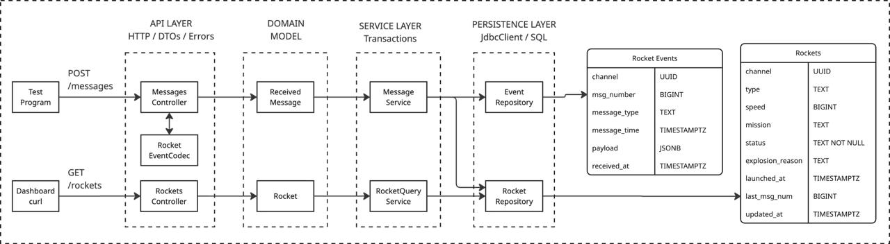
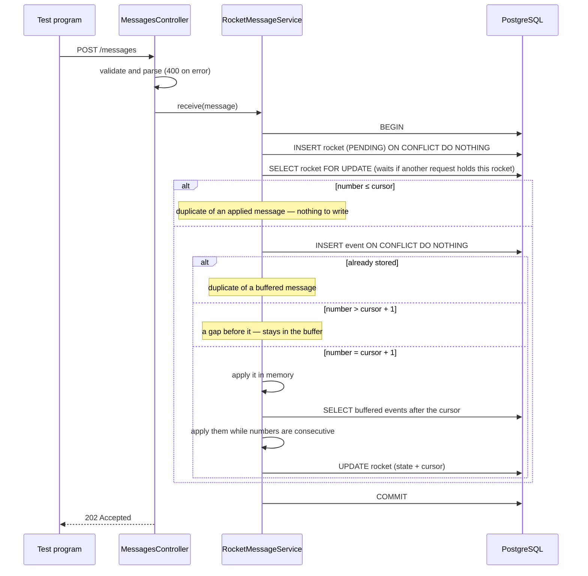
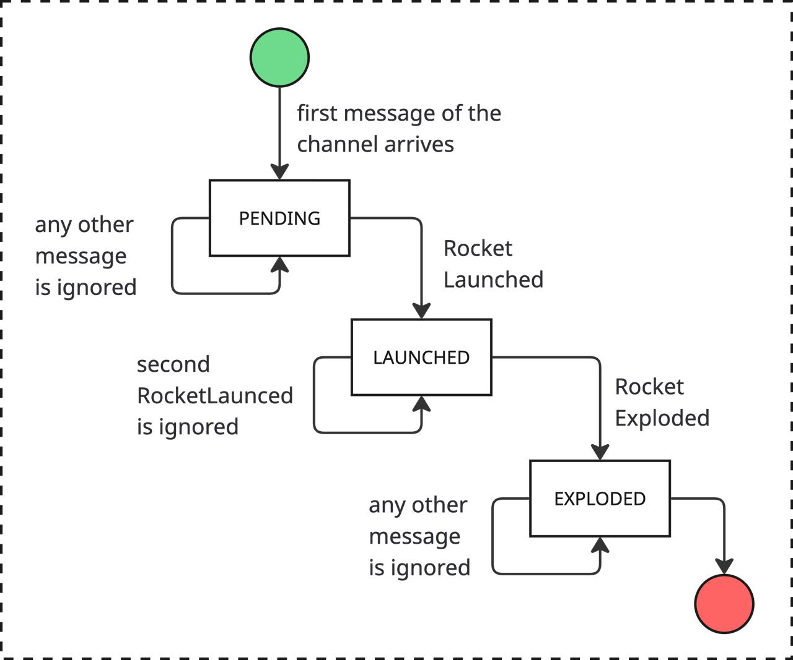
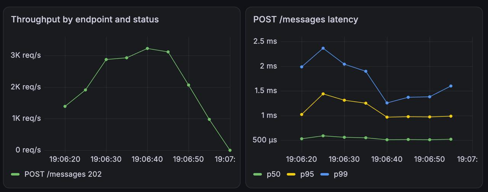
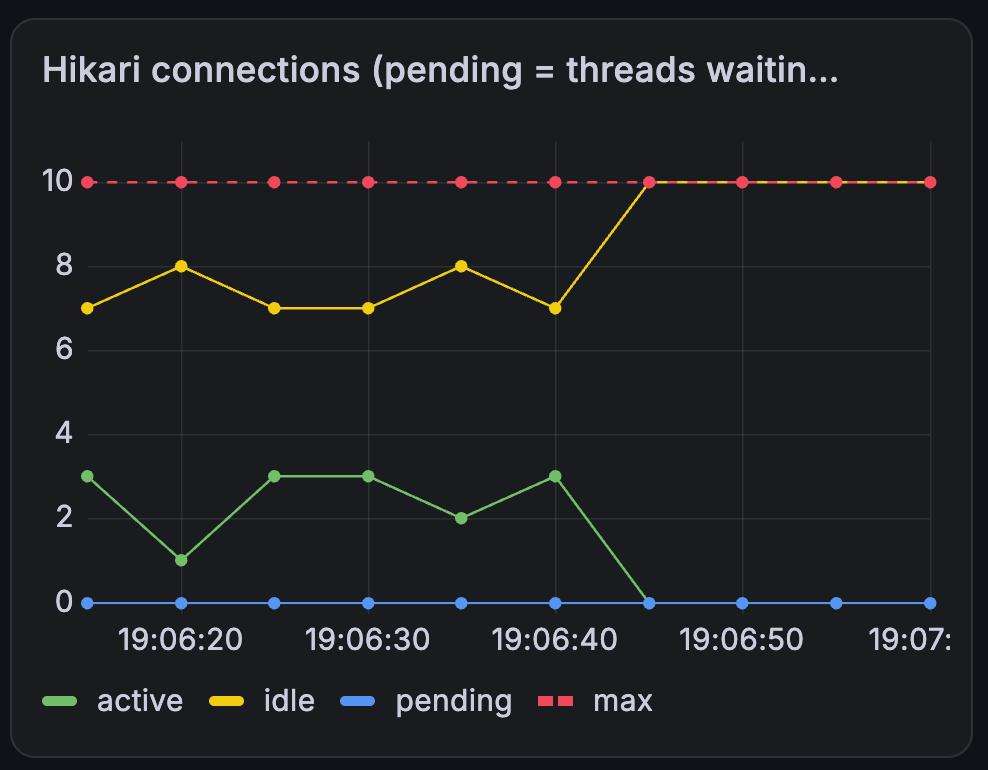
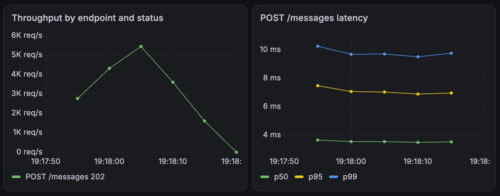
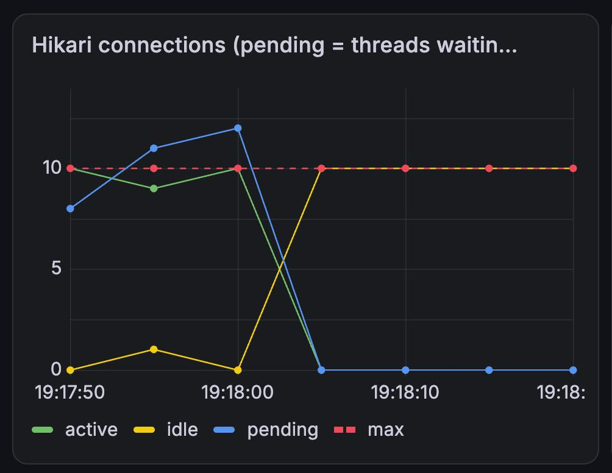

# Rockets 🚀

A Kotlin / Spring Boot service that consumes rocket state-change messages — which arrive **out of order** and
**at least once** — and exposes the current state of every rocket through a REST API.

How work on this project is organised, including how AI coding assistants are used: [CLAUDE.md](CLAUDE.md).

## Quick start

**Prerequisites:** Docker with Compose v2. That is all to run the service.

**1. Start PostgreSQL, the service and monitoring — from a clean state**

```bash
docker compose --profile monitoring down -v        # remove containers and the database volume of a previous run
docker compose --profile monitoring up -d --build
```

The first build takes 1–2 minutes (Gradle downloads its dependencies inside Docker); later builds use a cache.
The service listens on **http://localhost:8088**

**2. Run the test program**

```bash
./rockets launch "http://localhost:8088/messages"                       # as in the task: default values
./rockets launch "http://localhost:8088/messages" --max-messages=5000   # a quick run
```

By default it sends 100 000 messages with 3 concurrent workers and no delay.
On macOS, if the binary is killed immediately, remove the download quarantine first:
`xattr -d com.apple.quarantine rockets`.

**3. Look at the rockets**

```bash
curl -s localhost:8088/rockets                                          # all rockets, newest launch first
curl -s 'localhost:8088/rockets?sort=speed&order=desc'                  # fastest first
curl -s 'localhost:8088/rockets?status=LAUNCHED&minSpeed=10000'         # fast rockets still flying
curl -s localhost:8088/rockets/<channel>                                # one rocket (channel from the list above)
```

**4. Watch it**

- Grafana: http://localhost:3000/d/rockets-load-test — throughput, latency percentiles, errors, connection and thread pools
  (no login; local use only).

**5. Stop**

```bash
docker compose --profile monitoring down        # keep the database volume
docker compose --profile monitoring down -v     # also delete the data
```

## API

| Method | Path | Purpose | Success | Errors |
|---|---|---|---|---|
| `POST` | `/messages` | Receive a rocket message (used by the test program) | `202` | `400`, `500` |
| `GET` | `/rockets/{channel}` | Current state of one rocket (`404` if unknown or not launched yet) | `200` | `400`, `404` |
| `GET` | `/rockets` | All rockets, sorted and filtered | `200` | `400` |
| `GET` | `/actuator/health` | Health check | `200` | |
| `GET` | `/actuator/prometheus` | Metrics for Prometheus | `200` | |

`GET /rockets` parameters: `sort` = `speed` | `type` | `mission` | `status` | `launchedAt` (default),
`order` = `asc` | `desc` (default), `status` = `LAUNCHED` | `EXPLODED`, `minSpeed` / `maxSpeed` (inclusive).

All errors are returned as [RFC 9457 Problem Details](https://www.rfc-editor.org/rfc/rfc9457)
(`application/problem+json`):

```json
{ "type": "about:blank", "title": "Bad Request", "status": 400,
  "detail": "Unknown sort 'name', allowed: speed, type, mission, status, launchedAt" }
```

## Architecture

One stateless service in front of PostgreSQL. All state lives in the database, so the service can be restarted
or run as several instances (see [Scaling](#scaling)).



How it works, and why:
- every message is stored in an **event log** (RocketEvents) and applied to the rocket's state strictly in `messageNumber` order,
  tracked by a per-rocket **cursor**: early messages wait for the gap to be filled, duplicates are dropped.
  Out-of-order messages need a buffer anyway; keeping all events also allows rebuilding the state;
- concurrent requests for the same rocket are serialised by a **PostgreSQL row lock** (`SELECT ... FOR UPDATE`);
  different rockets run in parallel. Without the lock two transactions miss each other's inserts and a message can stay
  unapplied; optimistic locking or a stricter isolation level would need retries, and with 3 workers on ~20 rockets
  conflicts are the normal case;
- processing is **synchronous, in one transaction**, with no background worker: `202 Accepted` is returned only after
  commit, so together with the sender's redelivery on non-2xx it gives at-least-once end to end.

Stack: Kotlin, Spring Boot 4, PostgreSQL 17, Flyway, Spring JDBC (`JdbcClient`), JUnit 5 + Testcontainers;
optional Prometheus + Grafana.

### Processing a message



A message that arrives early is only stored; the request that fills the gap applies it.

### Rocket state



## Failure handling

The sender redelivers a message until it gets a `2xx`. The service is built so that redelivery is always safe:

- **Atomic.** A message is stored and applied in one transaction. On any failure everything is rolled back —
  no partial state — and the client gets `500`. `202` is sent only after `COMMIT`.
- **Idempotent.** A redelivered message is dropped by the cursor (already applied) or by the primary key (still buffered).
  This also covers the ambiguous cases: committed but the `202` got lost, or the connection dropped during `COMMIT` —
  the retry is either a harmless duplicate or the first successful write.
- **Nothing is lost while a message is failing.** Later messages of that rocket wait in the buffer behind the gap;
  once the redelivered message succeeds, it fills the gap and applies them. The state only lags behind for a moment.

Two consequences are accepted on purpose — invalid messages are redelivered forever, and a poison event blocks its
rocket; see [Accepted limitations](#accepted-limitations).

## Testing

```bash
./gradlew test        # needs JDK 21 and a running Docker: Testcontainers starts its own PostgreSQL
```

79 tests, about 10 seconds:

- **Unit** — the state transition rules (`Rocket.applyMessage`) and message parsing / validation; no Spring, no database.
- **Web slice** (`@WebMvcTest`) — the HTTP contract: `202`, every kind of `400` / `404` / `500` as Problem Details.
- **Integration, real PostgreSQL** — the repositories' SQL; ordering scenarios (reverse order, a gap filled later,
  duplicates, events after an explosion); the full `POST` → `GET` flow over HTTP.
- **Concurrency** — 8 threads deliver shuffled messages with duplicates at the same moment; the final state must equal
  in-order delivery.

## Load test

Measured on one laptop shared by the test program, the service, PostgreSQL and monitoring — the numbers are relative.

**3 workers (default):**

<p>
  
  
</p>

**25 workers:**

<p>
  
  
</p>

| | 3 workers (default) | 25 workers |
|---|---|---|
| 100 000 messages in | 34 s (~2 900 msg/s) | 18 s (~5 600 msg/s) |
| Latency p50 / p99 | 0.5 / 1.8 ms | 3.5 / 9.7 ms |
| Connection pool (10): busy / waiting, max | 3 / 0 | 10 / 12 |
| Errors | 0 | 0 |

After both runs the state is correct: 100 000 of 100 000 messages applied, none left in the buffer, no rocket below
its launch speed.

- **The default load is far from the limits:** p99 ≈ 2 ms, the pool is 30 % used and nobody waits for it.
- **At 25 workers the connection pool is the first bottleneck:** 8× the workers give 1.9× the throughput and 5× the p99,
  and over half of the response time is spent waiting for one of the 10 connections.

## Scaling

The service is stateless and serialises per rocket **in the database**, not in the JVM, so several instances behind a
load balancer work without changes. Further steps, in the order they pay off — each one triggered by a measurement:

| Step | What | Relieves |
|---|---|---|
| 1. Less work per message | In the common case a transaction runs 5 statements; 3 are enough (don't re-insert an existing rocket row, don't query an empty buffer). Keeping only buffered events, without history, brings it to 2. | Connections and row locks are held for less time — the only lever for a single rocket's throughput |
| 2. Pool size by experiment | Measure 10 / 20 / 40 connections at the target load; bigger is not automatically better for PostgreSQL | The queue for connections — the first bottleneck above |
| 3. N instances + PgBouncer | Load balancer in front; PgBouncer in transaction mode keeps PostgreSQL's connection count low | Service CPU and threads |
| 4. Reads off the primary | `GET` from a read replica or a short-lived cache | Dashboard reads competing with writes |
| 5. Kafka, partitioned by `channel` | `POST` appends to a topic and returns `202`; one consumer per partition applies a rocket's messages in order without lock waits, and in batches — one `UPDATE` per rocket per batch | Write load on the database; accepting messages while the database is down |
| 6. Shard by `channel` | A natural shard key: no transaction spans two rockets | The limits of a single primary |

## Accepted limitations

Left out on purpose in favour of a simpler solution — and what would change the decision:

- **One service, no message broker.** The sender's redelivery already gives at-least-once with this design,
  and the assessed load uses a third of one instance's pool. Kafka pays off when the primary's write throughput
  becomes the limit or messages must be accepted while the database is down (step 5 in [Scaling](#scaling)).
- **No gap timeout.** A message that never arrives holds back the later messages of its rocket (they wait in the buffer).
  Fine under at-least-once; if a sender could lose messages: skip a gap after a timeout (`received_at` is stored) and alert.
- **Invalid messages get `400` and are redelivered forever.** The test program sends only valid messages;
  a real integration would park them in a dead-letter table and answer `2xx`.
- **The event log grows forever** — partition or archive it by time once it matters.
- **No pagination** on `GET /rockets` — not needed for ~20 rockets; the response object allows adding it.
- **No authentication; metrics and Grafana are open.** Local setup for the challenge; in production: auth at the gateway,
  a separate management port, credentials from a secrets manager.
